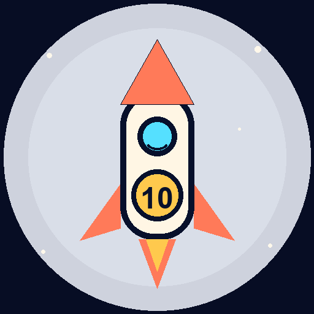

# 淘淘飞船 · 14 天太空课 v2.5

给 5 岁小朋友做的「凑十法 / 破十法」太空动画课。**颜色跟随系统浅色 / 深色自动切换**，iPad 横屏优先，孩子自己打卡。

这一版把 14 天课程改成 **三页互动动画课**：第一页就能用手拖星星，拖够了才继续，不再点数字。

- **14 个学习日，每天 5 道题**：14 × 5 = 70 道不重复的课程题。周一到周五上课，周六周日休息。
- 第 1、2 课：原来的凑十 / 破十动画。
- 第 3—14 课：每课一个新场景 + 三页动画：
  - 第 1 周：**积木小车、天平、小火车**。
  - 第 2 周：**吊车、水管、糖果罐、电梯、太空邮袋**。
  - 第 3 周：**星星桥、太空花园、齿轮站、返回舱**。
- 凑十课：把补给舱的星星拖进小车，一颗一颗装满 10 格。
- 破十课：把要减掉的星星拖进黑洞，一颗一颗拿走。
- 拖够数量之前「继续航行」是灰的；拖够后出现「继续」，底部算式变成绿色。
- 拖动、放下、完成时都有震动反馈；iPhone Safari 不支持系统震动，会自动改成画面轻弹。
- 家长报告、错题返航、打卡、深浅色都保留。
- 已支持 **PWA**：添加到 iPad / 手机主屏幕、离线打开。

## 14 天怎么排

按你确认的：**14 个学习日**，周六周日不排课。实际跨 3 周：

- 第 1 周：第 1—5 课
- 周六、周日：休息
- 第 2 周：第 6—10 课
- 周六、周日：休息
- 第 3 周：第 11—14 课，周五自由飞

### 课程表

| 课 | 星球 | 场景 | 数学 | 形式 |
| --- | --- | --- | --- | --- |
| 1 | 地球轨道 | 凑十补给站 | 9 加几 | 5 题动画 |
| 2 | 月球背面 | 破十陨石带 | 十几减 9 | 5 题动画 |
| 3 | 火星 | 积木小车 | 9 + 4 | 5 题动画 |
| 4 | 金星 | 天平 | 14 − 9 | 5 题动画 |
| 5 | 水星 | 小火车 | 8 + 6 | 5 题动画 |
| 6 | 木星 | 吊车 | 9 + 6 | 5 题动画 |
| 7 | 土星 | 水管 | 15 − 8 | 5 题动画 |
| 8 | 天王星 | 糖果罐 | 16 − 9 | 5 题动画 |
| 9 | 海王星 | 电梯 | 7 + 6 | 5 题动画 |
| 10 | 柯伊伯带 | 太空邮袋 | 13 − 8 | 5 题动画 |
| 11 | 织女星 | 星星桥 | 8 + 7 | 5 题动画 |
| 12 | 猎户座 | 太空花园 | 16 − 6 | 5 题动画 |
| 13 | 银河中心 | 齿轮站 | 9 + 8 | 5 题动画 |
| 14 | 返回地球 | 返回舱 | 17 − 9 | 5 题动画 |

14 课一共 **70 道不重复的题目**：每课 5 道，14 × 5 = 70。表里只列每课的第一道示例，实际每课会按顺序做 5 道。自由练习会复用题库，但课程题目不重复。

## 通过才能飞下一站

- 第 1 课默认解锁。
- 把星星拖够、走完三页动画后，弹出「本课通过」。
- 答错不会扣星，会留在检查里重试；错的题会记进错题本。
- 通过后弹「本课通过！」，点「飞往第 N 课」，火箭先飞到下一颗星球。
- 没通过的下一课在课程表里是灰色锁定状态，不能直接点。
- 按顺序走完 14 课，最后一课返航地球。

## 动画场景

### 第 1 周

- **积木小车**：车厢 10 个格子，搬积木补满 10。
- **天平**：左右托盘，10 块一摞，拿走要减掉的。
- **小火车**：10 个座位，乘客上车 / 下车。

### 第 2 周

- **吊车**：吊钩把货物吊进 10 格货台。
- **水管**：往水箱里灌水补满 10 格。
- **糖果罐**：把糖果放进罐子凑 10。
- **电梯**：乘客进电梯，凑满 10 位。
- **太空邮袋**：把包裹装进邮袋。

### 第 3 周

- **星星桥**：铺桥板补满 10 块。
- **太空花园**：种种子，凑满 10 颗。
- **齿轮站**：转动齿轮，把 10 齿拆开。
- **返回舱**：装行李，完成最后的破十。

每个场景都有自己的容器、颜色、单位、装/卸动作，不再重复前一周的动画。

## 家长报告

从课程表右上角「家长报告」或首页「给爸爸妈妈」进入。

- 打卡天数
- 完成课程 x/14
- 答题次数
- 正确率
- 最近 7 天
- 错题本

报告只做记录，不排名、不催速度。

## 错题返航

- 自由练习里答错的题会自动进错题本；课程拖拽不计错。
- 在报告里点「练错题」，进入单独的错题练习。
- 答对后自动移出错题本。
- 没有错题时显示「暂时没有错题」，不硬凑题。

## 声音

- 共 **299 段预录音频**：两关讲解、星球动画课、自由练习、完成反馈。
- 使用 Xiaoyi 年轻女声的原本音高，语速放慢，台词口语化。
- 用同音字「能亮」校正「量」的声调，听起来仍是 **能量星（néng liàng xīng）**；画面保留「能量星」。
- 音频、JS、CSS 使用 `v=22` 版本号，避免旧缓存。
- 浏览器可能拦截第一步自动播放；点「再听一遍」即可。

## 动画和音效

- 发射、星球飞行、积木装车、天平摆动、小火车上下客、下一题过场、完成彩纸。
- 发射和完成音效调大；其余音效压在童声下面。
- 所有音效受右上角声音开关控制。

## 手机 / iPad

- iPad 1024×768 是主设计；首页、课程、互动动画一屏能放下。
- 手机 390px 已测试：没有横向溢出，页面纵向滚动。
- 手机上顶部导航会收起；点左上角「淘淘飞船」回首页，点「航行 / 星星」去打卡日志。
- 课程表在手机上是一列卡片；家长报告、错题、互动动画都能正常用。
- PWA 的 `orientation` 是 `any`，手机竖屏、横屏都不会被强制旋转。

手机预览：[首页](preview/mobile-home.png) · [课程表](preview/mobile-course.png) · [课程](preview/mobile-lesson.png) · [家长报告](preview/mobile-report.png)

## PWA / 添加到主屏幕



- 已加 `manifest.webmanifest`、`sw.js` 和 192 / 512 / 180 三种图标。
- iPad Safari：分享 → 添加到主屏幕；打开后是独立窗口，没有地址栏。
- 支持离线打开：核心页面、课程、报告、图标会缓存；播放过的音频也会缓存。
- 新版本要更新缓存时，改 `sw.js` 里的 `VERSION` 和页面里的 `?v=` 版本号。
- 已测试：断网后重新打开，14 天航线和页面仍能显示。
- **iPad 真离线需要 HTTPS**：`localhost` 可以直接测试；局域网 `http://192.168.x.x` 不能注册 Service Worker。发布步骤见 [DEPLOY.md](DEPLOY.md)，打包文件是项目根目录的 `math-magic-pwa.zip`。

## 预览

带示例数据（12 天打卡、4 课完成、错题本 1 题）：

- [跟随系统预览](http://127.0.0.1:4173/?demo=1&v=22)
- [空白版](http://127.0.0.1:4173/?v=22)
- [深色](http://127.0.0.1:4173/?demo=1&theme=dark&v=22)

## UI 预览

| 页面 | 浅色 | 深色 |
| --- | --- | --- |
| 首页 | [light-home.png](preview/light-home.png) | [dark-home.png](preview/dark-home.png) |
| 14 天航线 | [light-course.png](preview/light-course.png) | [dark-course.png](preview/dark-course.png) |
| 飞往星球 | [light-lesson-flight.png](preview/light-lesson-flight.png) | — |
| 积木小车 | [light-lesson-truck.png](preview/light-lesson-truck.png) | — |
| 天平 | [light-lesson-balance.png](preview/light-lesson-balance.png) | — |
| 小火车 | [light-lesson-train.png](preview/light-lesson-train.png) | — |
| 步骤互动 | [light-step-interaction.png](preview/light-step-interaction.png) | [mobile-step-interaction.png](preview/mobile-step-interaction.png)（手机） |
| 吊车 | [light-lesson-crane.png](preview/light-lesson-crane.png) | — |
| 星星桥 | [light-lesson-bridge.png](preview/light-lesson-bridge.png) | — |
| 破十拖一拖 | [light-break-drag.png](preview/light-break-drag.png) | — |
| 拖动成功 | [light-drag-success.png](preview/light-drag-success.png) | — |
| 本课通过 | [light-lesson-complete.png](preview/light-lesson-complete.png) | — |
| 家长报告 | [light-report.png](preview/light-report.png) | — |
| 自由练习 | [light-practice.png](preview/light-practice.png) | [dark-practice.png](preview/dark-practice.png) |
| 答对反馈 | [light-practice-correct.png](preview/light-practice-correct.png) | — |
| 答错反馈 | [light-practice-wrong.png](preview/light-practice-wrong.png) | — |
| 自由练习完成 | [light-practice-complete.png](preview/light-practice-complete.png) | — |
| 航行日志 | [light-calendar.png](preview/light-calendar.png) | — |
| 打卡弹窗 | [light-checkin.png](preview/light-checkin.png) | — |
| 发射动画 | [light-launch.png](preview/light-launch.png) | — |

手机端自由练习：[mobile-practice.png](preview/mobile-practice.png)

## 目录

```text
math-magic/
├─ index.html
├─ styles.css          # 基础布局和通用组件
├─ theme-space.css     # 太空主题、浅色/深色、多种场景、报告、动画
├─ app.js              # 14 天课程、动画、报告、错题、语音
├─ manifest.webmanifest
├─ sw.js               # 离线缓存
├─ icons/              # 192 / 512 / 180 图标
├─ audio/              # 299 段预录童声
├─ DEPLOY.md           # iPad HTTPS 真离线部署
├─ README.md
└─ preview/
   └─ 浅色/深色截图
```

## 下一步

1. **更多场景**：火箭电梯、海底潜水、太空厨房等，继续避免场景重复。
2. **扩题库**：14 课后继续加 20 以内加减。
3. **真人童声录音**：如果想彻底去掉合成感，可以按录音表换真人。
4. **每日提醒**：周一到周五提醒，周末不打扰。
5. **PWA 更新提示**：新版本发布时提示家长刷新。

如果这版 14 课拖拽动画、PWA 都没问题，我下一步继续扩题库和加每日提醒。
